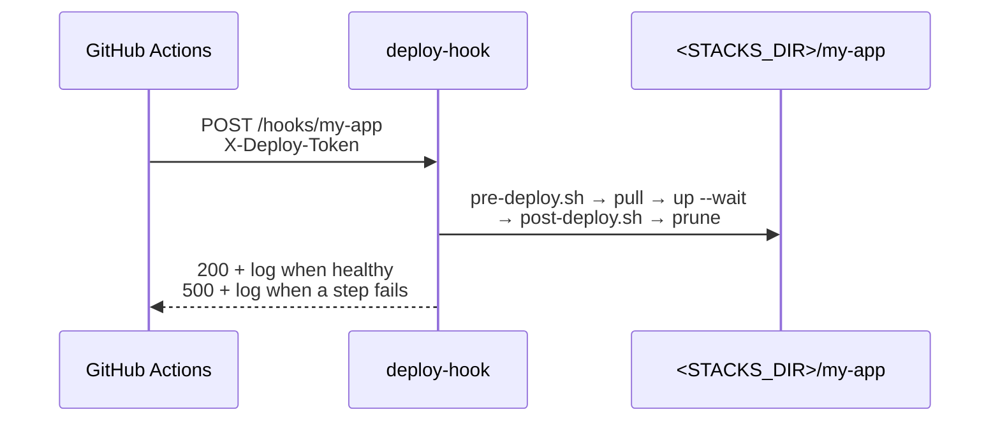

# deploy-hook

One small container that redeploys any Docker Compose stack on your host when
CI asks it to. No database, no UI, no Git checkout on the server: just
[webhook](https://github.com/adnanh/webhook), the Docker CLI and two shell
scripts.



The response waits for the deploy, so the CI step shows the log and turns red
when a service doesn't get healthy.

## Set up the host

1. Copy [`compose.yaml`](compose.yaml) and [`.env.example`](.env.example) (as
   `.env`) into a folder of their own, e.g. `<STACKS_DIR>/deploy-hook`, and
   fill in `.env`.
2. `docker compose up -d`
3. Point your reverse proxy at `deploy-hook:9000` over HTTPS. Set its response
   timeout to at least 15 minutes, since the response waits for the whole
   deploy: `pre-deploy.sh` and `pull` have no time limit of their own, and
   `up --wait` may take up to `DEPLOY_WAIT_TIMEOUT`.

## Add a stack

A stack is a folder directly in `STACKS_DIR` that Docker Compose can run
(`compose.yaml`, `compose.yml`, `docker-compose.yaml` or `docker-compose.yml`).
It gets a hook as soon as it has a `.deploy/token` (the hook doesn't check for
the Compose file; a stack without one fails at deploy time):

```sh
cd <STACKS_DIR>/my-app
mkdir -p .deploy
openssl rand -hex 32 > .deploy/token && chmod 600 .deploy/token
docker exec deploy-hook deploy-hook reload
```

The URL is `/hooks/<id>`. The id is the folder name in lowercase with dashes
(`My App` → `my-app`), or the content of `.deploy/id`.

Files in `.deploy/`:

| File | | Purpose |
|---|---|---|
| `token` | required | 32+ characters of `A-Z a-z 0-9 _ -`. |
| `id` | optional | Overrides the id taken from the folder name. Lowercase letters, digits and dashes, starting with a letter or digit. |
| `pre-deploy.sh` | optional | Runs before `pull`, e.g. a backup. Non-zero exit stops the deploy. |
| `post-deploy.sh` | optional | Runs after all services are healthy. |

A stack with an invalid token or id, or an id another stack already uses, gets
no hook. The reason is in `docker logs deploy-hook`.

Scripts run with `sh` in the stack folder, with the Docker CLI available and
`STACK_DIR` and `DEPLOY_ID` set. For example:

```sh
# .deploy/pre-deploy.sh
docker compose exec -T backup backup now
```

## Call it from GitHub Actions

```yaml
jobs:
  deploy:
    runs-on: ubuntu-latest
    concurrency: { group: deploy, cancel-in-progress: false }
    steps:
      - uses: saminitz/deploy-hook@v1
        with:
          url: https://deploy.example.com/hooks/my-app
          token: ${{ secrets.DEPLOY_HOOK_TOKEN }}
```

Inputs: `url`, `token`, `timeout` (seconds, default `900`). The step log shows
the deploy output, and the job summary shows its last 20 lines.

Any other client works too:

```sh
curl -fsS -X POST -H "X-Deploy-Token: $TOKEN" https://deploy.example.com/hooks/my-app
```

## Reference

**Responses:** `200` deployed · `500` a step failed · `401` wrong or missing
token · `404` unknown id · `405` not a POST. Requests for the same stack run
one after the other. Different stacks deploy in parallel.

**Environment** (set in `.env`):

| Variable | Default | |
|---|---|---|
| `STACKS_DIR` | required | Folder with one folder per stack, mounted at the same path. |
| `DOCKER_CONFIG_DIR` | `./docker` | Host folder with `config.json` from `docker login`, for private images. |
| `PROXY_NETWORK` | `proxy` | Docker network of the reverse proxy. |
| `DEPLOY_WAIT_TIMEOUT` | `600` | Seconds `docker compose up --wait` may take. |
| `DEPLOY_PRUNE` | `true` | `false` skips `docker image prune -f`. |

**Reload:** `docker exec deploy-hook deploy-hook reload` rereads all tokens
without interrupting a running deploy. A restart does the same but cuts off
running deploys.

## Security

The container has the Docker socket, which means root on the host. Treat
every token like an SSH key for that host. Use one token per stack, keep
tokens in CI secrets only, and serve the hook over HTTPS. Tokens are compared
in constant time and never logged. The hook's own folder must not have a
`.deploy/token`.

## Development

```sh
test/run.sh   # builds the image and deploys throwaway stacks (needs Docker and curl)
```

Pushes to `main` publish `ghcr.io/saminitz/deploy-hook:latest` and
`sha-<short>`. Tags `v1.2.3` publish `1.2.3`, `1.2` and `1`.

The action's `@v1` is a Git tag, separate from the image tags. CI ignores it,
so move it by hand after each release:

```sh
git tag -f v1 v1.2.3 && git push -f origin v1
```

## License

[AGPL-3.0](LICENSE)
